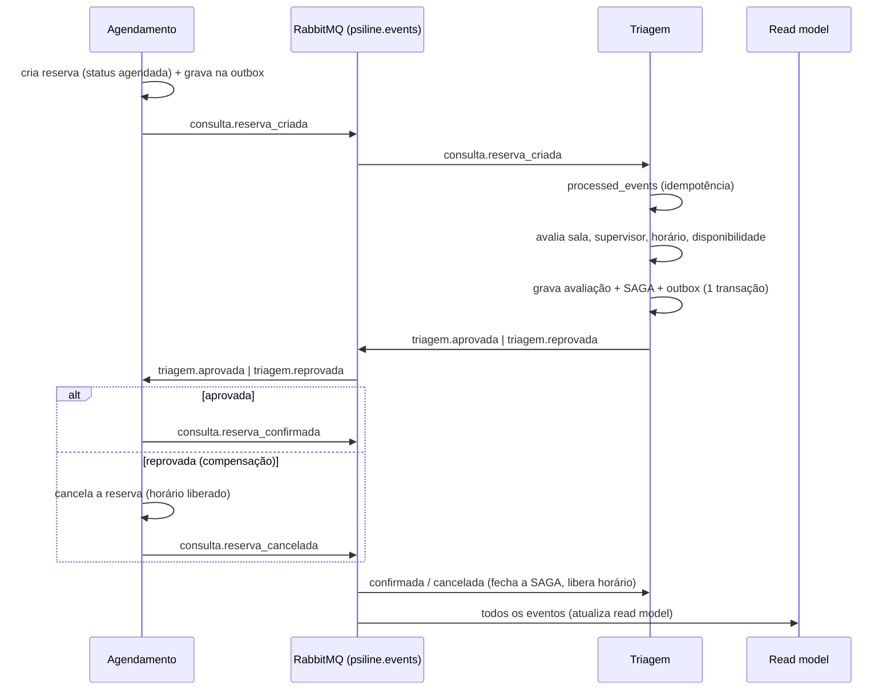

# Serviço de Triagem e SAGA (Parte 3)

O serviço de triagem valida as reservas criadas pelo serviço de agendamento e
participa da SAGA que confirma ou cancela cada reserva. Ele tem **banco próprio**
e só conversa com os outros serviços por eventos no RabbitMQ.

## Fluxo



## Contrato dos eventos

Todos os eventos usam o mesmo envelope (`event_version` = 1):

| Campo | Descrição |
|---|---|
| `event_id` | UUID do evento (chave de idempotência) |
| `event_type` | Tipo do evento (também é a routing key) |
| `event_version` | Versão do contrato (inteiro) |
| `consulta_id` | Identificador da consulta |
| `occurred_at` | Data/hora de criação, ISO 8601 |
| `causation_id` | Opcional: `event_id` do evento que causou este |
| `data` | Dados específicos do evento |

Dados (`data`) de cada evento:

| Evento | Produtor | `data` |
|---|---|---|
| `consulta.reserva_criada` | Agendamento | `paciente_nome`, `estagiario_id`, `professor_id`, `sala`, `inicio`, `fim` (ISO 8601) |
| `triagem.aprovada` | Triagem | `estagiario_id`, `professor_id`, `sala`, `inicio`, `fim` |
| `triagem.reprovada` | Triagem | os mesmos campos + `motivo_codigo`, `motivo_detalhe` |
| `consulta.reserva_confirmada` | Agendamento | livre (a triagem só usa o envelope) |
| `consulta.reserva_cancelada` | Agendamento | livre; recomendado `motivo` |

Exemplo:

```json
{
  "event_id": "5b0f9f0e-3a43-4a53-8c1e-0a1a3c0d7f10",
  "event_type": "triagem.reprovada",
  "event_version": 1,
  "consulta_id": 42,
  "occurred_at": "2026-11-19T13:00:00.000Z",
  "causation_id": "c3f1d2a0-1d5e-4a73-9a52-6a5d7c1a9b00",
  "data": {
    "estagiario_id": 4, "professor_id": 2, "sala": "Sala 99",
    "inicio": "2026-11-25T13:00:00Z", "fim": "2026-11-25T13:50:00Z",
    "motivo_codigo": "SALA_INDISPONIVEL",
    "motivo_detalhe": "A sala \"Sala 99\" não existe ou está inativa."
  }
}
```

## Regras de triagem

As regras rodam em ordem; a primeira que falhar reprova a reserva.

| Código | Regra |
|---|---|
| `PAYLOAD_INVALIDO` | `data` incompleto ou com valores inválidos |
| `HORARIO_NO_PASSADO` | início já passou |
| `DURACAO_INVALIDA` | duração fora de 30 min a 2 h |
| `FORA_DO_EXPEDIENTE` | fora de 8h–20h (`EXPEDIENTE_INICIO` / `EXPEDIENTE_FIM`) |
| `SALA_INDISPONIVEL` | sala inexistente ou inativa |
| `SUPERVISOR_INVALIDO` | professor não é o supervisor ativo do estagiário |
| `ESTAGIARIO_OCUPADO` | estagiário já tem reserva aprovada no horário |
| `SALA_OCUPADA` | sala já reservada no horário |
| `HORARIO_CONFLITANTE` | duas aprovações simultâneas (barrada pela constraint do banco) |

Para não depender do banco do agendamento, a triagem mantém os próprios dados de
referência (`salas`, `supervisoes`) e a lista de horários que ela aprovou
(`reservas_triagem`, com *exclusion constraints* do PostgreSQL contra conflitos).

## Idempotência

- Cada mensagem processada grava seu `event_id` em `processed_events`
  (índice único, `INSERT ... ON CONFLICT DO NOTHING`).
- O registro do `event_id`, a avaliação, a SAGA e a outbox são gravados **na mesma
  transação**. Se a transação falha, nada é gravado e a mensagem pode ser reprocessada.
- A mensagem só é confirmada (`ack`) depois do commit. Se o processo cair no meio,
  o broker reentrega e o `event_id` já registrado evita o efeito duplicado.
- Uma segunda proteção: `avaliacoes_triagem.consulta_id` é único, então a mesma
  consulta nunca é triada duas vezes, mesmo com `event_id` diferente.

## Outbox (lado da triagem)

`triagem.aprovada` / `triagem.reprovada` são gravados em `outbox_events` na mesma
transação da avaliação. O processo `triagem:publicador` lê os pendentes
(`FOR UPDATE SKIP LOCKED`), publica com *publisher confirms* e só então marca
`published_at`. Garantia: **pelo menos uma vez**; duplicatas são absorvidas pelos
consumidores idempotentes.

## SAGA

Coreografia: cada serviço reage aos eventos do outro. A triagem guarda o estado da
SAGA de cada reserva em `sagas` (com histórico):

```
AGUARDANDO_TRIAGEM ─▶ TRIAGEM_APROVADA ─▶ CONFIRMADA
                  │            └────────▶ CANCELADA
                  ├─▶ TRIAGEM_REPROVADA ─▶ COMPENSADA
                  └─▶ CANCELADA
```

| Evento recebido | Efeito na triagem |
|---|---|
| `consulta.reserva_criada` | avalia → `TRIAGEM_APROVADA` ou `TRIAGEM_REPROVADA` |
| `consulta.reserva_confirmada` | `CONFIRMADA` |
| `consulta.reserva_cancelada` | `COMPENSADA` (se reprovada) ou `CANCELADA`; libera o horário em `reservas_triagem` |

**Compensação:** quando a triagem reprova, o agendamento cancela a reserva
(status `cancelada`, que já libera o horário nas constraints do banco do
agendamento) e publica `consulta.reserva_cancelada`.

## Topologia do broker

| Item | Nome (variável) |
|---|---|
| Exchange (topic, durável) | `psiline.events` (`EVENTS_EXCHANGE`) |
| Fila da triagem | `triagem.eventos` (`TRIAGEM_QUEUE`) |
| Bindings da fila | `consulta.reserva_criada`, `consulta.reserva_confirmada`, `consulta.reserva_cancelada` |
| Dead-letter exchange / fila | `psiline.events.dlx` / `triagem.eventos.dlq` |

Mensagem inválida vai direto para a DLQ; erro inesperado volta à fila uma vez e,
se falhar de novo, vai para a DLQ. Se a infraestrutura (Parte 2) já cria essas
filas, use `DECLARE_TOPOLOGY=false`.

## Executar localmente

```bash
cd triagem
docker compose up --build        # RabbitMQ, banco, web, consumidor e publicador
```

- API de consulta: `http://localhost:3100/api/v1/triagens/:consulta_id`
- Painel do RabbitMQ: `http://localhost:15672` (guest / guest)

Cenários de demonstração (o simulador faz o papel do agendamento):

```bash
docker compose exec triagem-web bin/rails "triagem:simular[sucesso]"
docker compose exec triagem-web bin/rails "triagem:simular[sala_invalida]"
docker compose exec triagem-web bin/rails "triagem:simular[conflito]"
docker compose exec triagem-web bin/rails "triagem:simular[duplicada]"
docker compose exec triagem-web bin/rails "triagem:simular[confirmar,<consulta_id>]"
docker compose exec triagem-web bin/rails "triagem:simular[cancelar,<consulta_id>]"
curl localhost:3100/api/v1/triagens/<consulta_id>
```

## Testes

```bash
docker compose run --rm -e RAILS_ENV=test triagem-web bash -lc "bin/rails db:prepare && bundle exec rspec"
```

Cobertura: sucesso, cada motivo de reprovação, reprocessamento da mesma
mensagem, mesma consulta com outro `event_id`, compensação, liberação do horário,
transições inválidas da SAGA, outbox e publicador, decisão de ack/DLQ.
